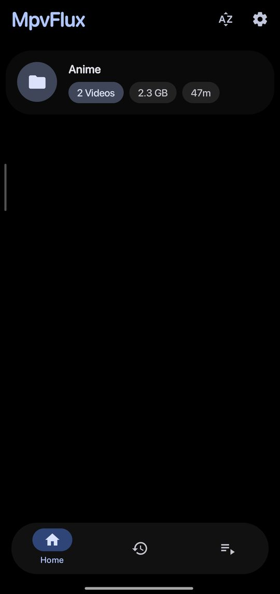
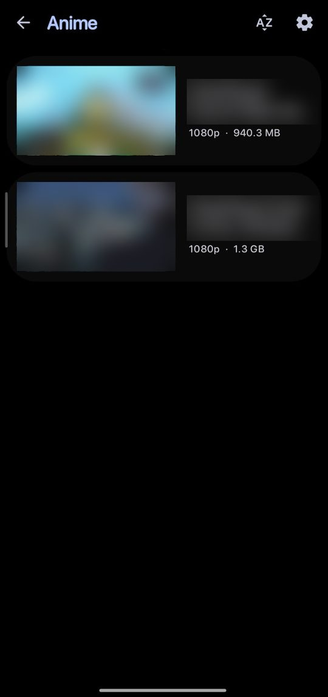
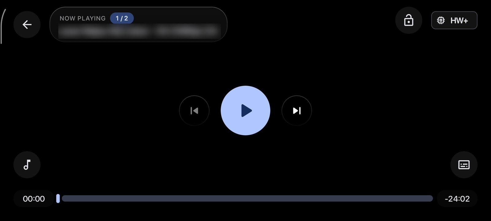

<div align="center">


# MpvFlux

**A fast, battery-friendly local video player for Android, built on mpv.**

Full ASS/SSA subtitle rendering, hardware decoding and a modern Material 3 design. Made with anime in mind.

[](https://github.com/Muhammedahmed18/mpvFlux/releases/latest)
[](https://github.com/Muhammedahmed18/mpvFlux/releases)
[](#-download)
[](LICENSE)

[**Download**](https://github.com/Muhammedahmed18/mpvFlux/releases/latest) · [Screenshots](#-screenshots) · [Features](#-features) · [Build](#-building-from-source) · [Report a bug](https://github.com/Muhammedahmed18/mpvFlux/issues)

</div>

---

## 📸 Screenshots

<div align="center">


&nbsp;




</div>

---

## ✨ Features

### 🎬 Playback
- **Powered by mpv:** plays practically any local video format.
- **Hardware decoding first:** uses MediaCodec and falls back to software only when needed.
- **Knows what your phone can decode:** the decoder sheet checks the video's codec, profile and resolution and explains when hardware decoding isn't available (for example AV1 or 10-bit H.264).
- **Picture-in-picture** and **background audio playback**.
- **Resume where you left off**, plus a recently played list and playlists.
- Frame-by-frame navigation, chapters, speed presets and a sleep timer.
- **Locked controls made for one hand:** a hold-to-unlock button where your right thumb rests, plus small pills showing the clock, time left and battery.
- Advanced users can edit `mpv.conf` directly in the app.

### 💬 Subtitles
- **Full ASS/SSA rendering** through libass, with your typesetting, karaoke and signs exactly as the fansub intended.
- **Online subtitle search with hash matching:** identifies your file from its first and last 64 KB, so the subtitles you find are synced to that exact release.
- **SRT/VTT subtitles use your phone's font**, including fonts from your phone's theme store. ASS/SSA keeps its original styling.
- **Preferred audio and subtitle language** picked from a list, matching every language code a file may use (`en`, `eng`, `en-US`…).
- **Subtitles off by default** if you prefer turning them on yourself.
- Custom fonts, styling, subtitle delay and secondary subtitles.

### 🔋 Battery and performance
- **No polling loops:** the player only reacts to real changes instead of checking every few milliseconds.
- **Video decoding pauses during background playback**, so audio-only listening doesn't waste power.
- **Smart media scanning:** an asynchronous scanner with caching keeps large libraries responsive, and full rescans are limited to once every 12 hours.
- **Lightweight thumbnail cache**, limited in size and cleaned up automatically.
- **No background work while you watch:** thumbnail generation pauses while a video is playing.

### 🎨 Design
- **Material 3 Expressive** UI with dynamic (wallpaper) colours and an OLED black option.
- Customizable gestures for volume, brightness and seeking, plus a custom player control layout.
- Folder and file browser with copy, move, rename and delete.

### 🔒 Privacy
No ads, no trackers, no analytics. Fully open source.

---

## 📥 Download

Get the latest APK from the [**Releases page**](https://github.com/Muhammedahmed18/mpvFlux/releases/latest).

| File | For |
|---|---|
| `mpvFlux-arm64-v8a-vX.Y.Z.apk` | Most phones (recommended) |
| `mpvFlux-armeabi-v7a-vX.Y.Z.apk` | Older 32-bit phones |
| `mpvFlux-x86_64-vX.Y.Z.apk` / `mpvFlux-x86-vX.Y.Z.apk` | Emulators, Chromebooks |
| `mpvFlux-universal-vX.Y.Z.apk` | Not sure? This one works everywhere |

**Requires Android 8.0 (API 26) or newer.**

> **Coming from mpvEx or MpvFlux 1.1.x?** Since 1.2.0, MpvFlux uses its own app ID
> (`app.marlboroadvance.mpvflux`), so it installs as a separate app. Your old watch
> history and settings don't carry over.

---

## 🛠️ Building from source

**You need:** Android Studio (latest stable) and JDK 17.

```bash
git clone https://github.com/Muhammedahmed18/mpvFlux.git
cd mpvFlux
./gradlew assembleDebug
```

The debug APK ends up in `app/build/outputs/apk/debug/`.

Release builds (`./gradlew assembleRelease`, or **Build → Generate Signed APK** in Android Studio) are named like the GitHub releases, e.g. `mpvFlux-arm64-v8a-v1.3.9.apk`, in `app/build/outputs/apk/release/` or the destination folder you choose.

---

## 🤝 Contributing

Bug reports, ideas and pull requests are welcome.

- **Found a bug?** [Open an issue](https://github.com/Muhammedahmed18/mpvFlux/issues/new?template=bug_report.md) and include your phone model, Android version and, if possible, the video file type.
- **Have an idea?** [Suggest a feature](https://github.com/Muhammedahmed18/mpvFlux/issues/new?template=feature_request.md).
- **Sending a PR?** Keep it focused on one change and use [Conventional Commits](https://www.conventionalcommits.org/) (`feat:`, `fix:`, `perf:`, `ui:`, …).

---

## 🙏 Credits

MpvFlux is a fork of [**mpvEx**](https://github.com/marlboro-advance/mpvEx) and stands on the shoulders of:

- [mpv](https://mpv.io/) and [mpv-android](https://github.com/mpv-android/mpv-android): the playback engine
- [libass](https://github.com/libass/libass): ASS/SSA subtitle rendering

## 📄 License

Released under the [Apache License 2.0](LICENSE).
