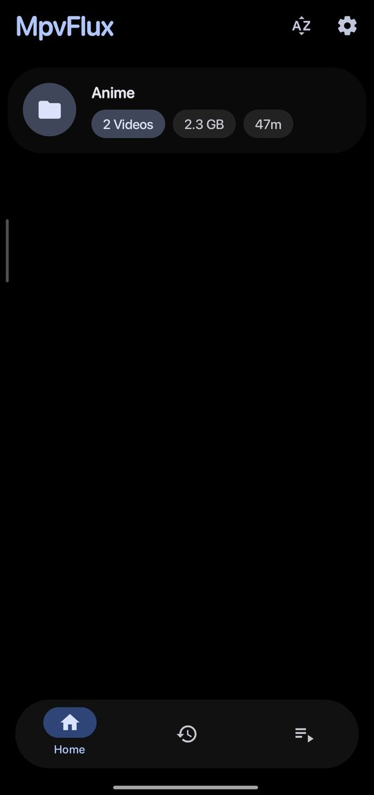
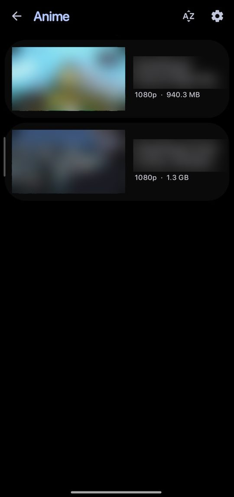
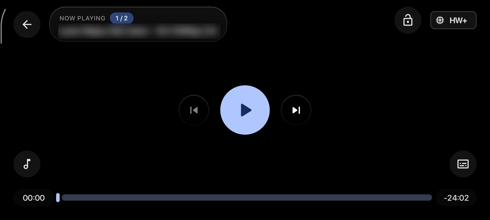

<div align="center">


# mpvFlux

### Your videos. Your subtitles. Your player.

A fast, battery-conscious Android video player powered by **mpv**, built with **Material 3 Expressive** and made with anime in mind.

<p>
  <a href="https://github.com/MpvFlux/mpvFlux/releases/latest"></a>
  <a href="https://github.com/MpvFlux/mpvFlux/releases"></a>
  
  <a href="LICENSE"></a>
</p>

**[Download latest APK](https://github.com/MpvFlux/mpvFlux/releases/latest)** · **[Explore features](#features)** · **[View screenshots](#screenshots)** · **[Report an issue](https://github.com/MpvFlux/mpvFlux/issues)**

</div>

---

## Why mpvFlux?

**Powerful playback, without the clutter.** mpvFlux combines mpv's format support and libass subtitle rendering with an Android-native interface, thoughtful playback controls, and local media management.

| 🎬 Playback | 💬 Subtitles | 🎨 Personalization |
| :--- | :--- | :--- |
| Hardware decoding, chapters, PiP, playback speed and resume | Full ASS/SSA rendering, SRT/VTT styling, language preferences and dual subtitles | Material 3 Expressive, dynamic colors, OLED black and customizable gestures |

## Screenshots

<div align="center">
  
  &nbsp;
  
  <p><sub>Browse your folders and video library</sub></p>
  
  <p><sub>Watch with a customizable, distraction-free player</sub></p>
</div>

## Features

### Playback that adapts to your device

- **Powered by mpv** for broad local video format support.
- **MediaCodec hardware decoding**, with software fallback when necessary.
- **Decoder information sheet** explaining codec, profile and resolution compatibility, including cases such as AV1 and 10-bit H.264.
- **Picture-in-picture** and **background audio playback**.
- **Playback history**, resume position, recently played videos and playlists.
- **Chapters**, frame-by-frame navigation, speed presets and a sleep timer.
- **One-handed locked controls** with hold-to-unlock and compact clock, remaining-time and battery indicators.
- **In-app `mpv.conf` editing** for advanced configuration.

### Subtitles, the way they were intended

- **ASS/SSA subtitles rendered with libass**, preserving typesetting, karaoke effects and signs.
- **Online subtitle search with file-hash matching**, using the first and last 64 KB of a video file.
- **SRT/VTT subtitles** displayed with your phone's font, including supported theme-store fonts.
- **Audio and subtitle language preferences**, including language-code variants such as `en`, `eng` and `en-US`.
- **Optional subtitles-off default**, plus custom fonts, styling, subtitle delay and secondary subtitles.

### Material 3 Expressive design

- **Dynamic wallpaper colors** and an **OLED black** option.
- **Customizable gestures** for volume, brightness and seeking.
- **Custom player control layout** designed for comfortable everyday use.
- **Built-in file management**: browse, copy, move, rename and delete files.

<details>
<summary><strong>Battery and performance optimizations</strong></summary>

<br />

- Event-driven playback state updates instead of frequent polling loops.
- Video decoding pauses during background audio playback to conserve power.
- Asynchronous media scanning with caching; full rescans are limited to once every 12 hours.
- Bounded thumbnail caching with automatic cleanup.
- Thumbnail generation pauses while a video is playing.

</details>

### Privacy first

**No ads. No trackers. No analytics.** mpvFlux is open source.

---

## Download

Get the APK from **[GitHub Releases](https://github.com/MpvFlux/mpvFlux/releases/latest)**.

**Minimum Android version:** Android 8.0 (API 26).

| APK variant | Recommended for |
| :--- | :--- |
| `arm64-v8a` | Most modern Android phones **(recommended)** |
| `armeabi-v7a` | Older 32-bit Android devices |
| `x86_64` / `x86` | Compatible emulators and Chromebooks |
| `universal` | When you're unsure which architecture to choose |

<details>
<summary><strong>Upgrading from mpvEx or mpvFlux 1.1.x?</strong></summary>

<br />

Since version 1.2.0, mpvFlux uses the app ID `app.marlboroadvance.mpvflux`. It installs separately from older versions, and existing watch history and settings are not transferred automatically.

</details>

## Build from source

**Requirements:** Android Studio (latest stable) and JDK 17.

```bash
git clone https://github.com/MpvFlux/mpvFlux.git
cd mpvFlux
./gradlew assembleDebug
```

Find the debug APK in `app/build/outputs/apk/debug/`.

For a release build, use `./gradlew assembleRelease` or **Build → Generate Signed APK** in Android Studio. Release APKs are generated under `app/build/outputs/apk/release/` or your selected output folder; naming follows the release variant and version.

## Contributing and feedback

Bug reports, suggestions and focused pull requests are welcome.

- **[Report a bug](https://github.com/MpvFlux/mpvFlux/issues/new?template=bug_report.md)** — include your device model, Android version and relevant video details.
- **[Suggest a feature](https://github.com/MpvFlux/mpvFlux/issues/new?template=feature_request.md)** — describe the use case and expected behavior.
- **Submit a pull request** — keep changes focused and use [Conventional Commits](https://www.conventionalcommits.org/) such as `feat:`, `fix:`, `perf:` or `ui:`.

## Credits

mpvFlux is a fork of **[mpvEx](https://github.com/marlboro-advance/mpvEx)**, built on excellent open-source projects:

- **[mpv](https://mpv.io/)** and **[mpv-android](https://github.com/mpv-android/mpv-android)** — playback engine and Android integration.
- **[libass](https://github.com/libass/libass)** — ASS/SSA subtitle rendering.

## License

Licensed under the **[Apache License 2.0](LICENSE)**.

<div align="center">
  <sub>Built for people who care about how their videos look, sound and play.</sub>
</div>
